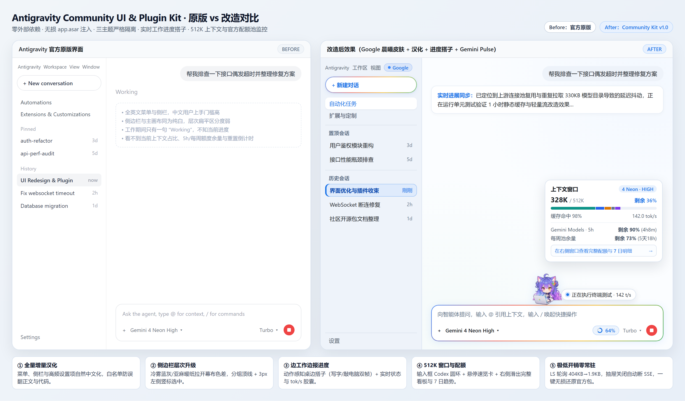
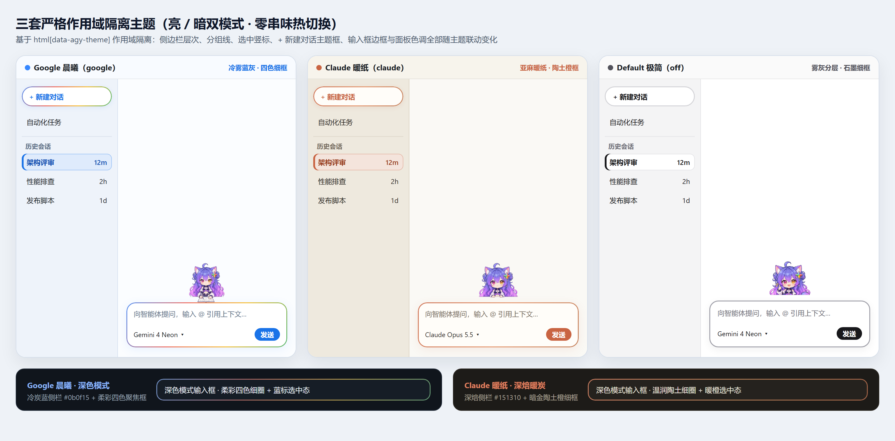
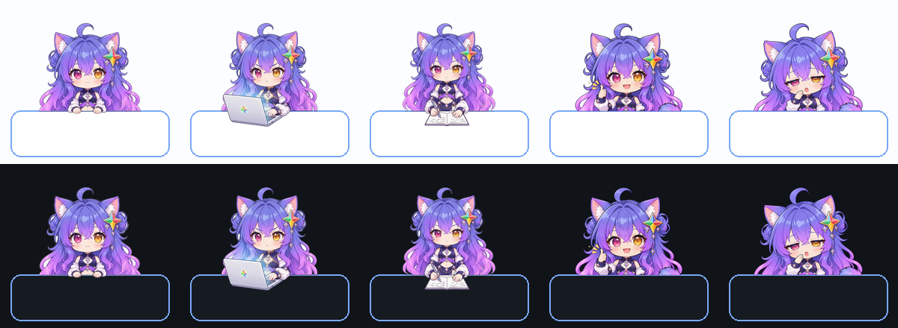
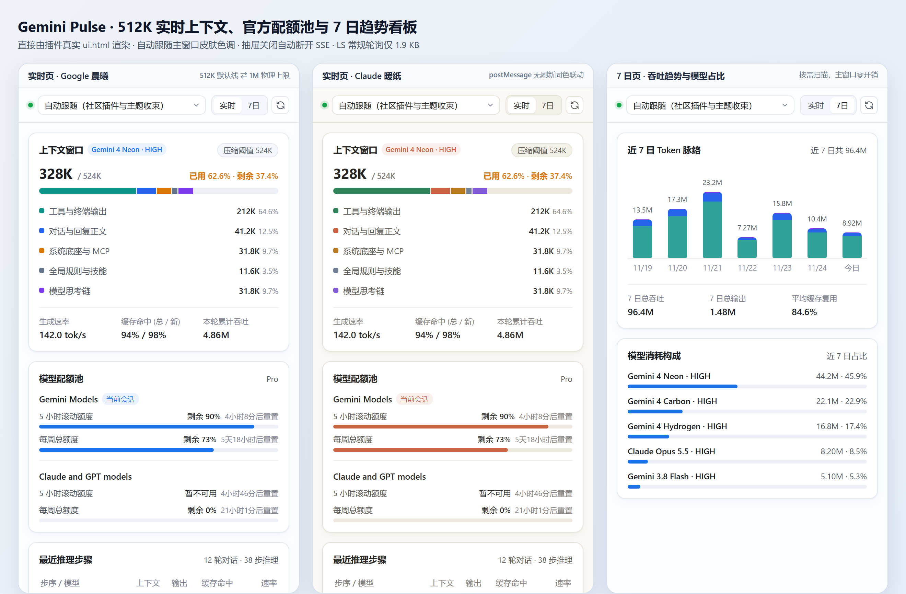

# Antigravity Community UI & Plugin Kit

> **一句话总结**：这是一个面向社区的 **Google Antigravity 桌面端界面美化与效率增强参考套件**——在不破坏官方安装包的前提下，为 Antigravity 补齐 **6 格实体指针主题转盘（6 套亮/暗美术皮肤 + 顶栏实时同步）、28 帧全动作随主题换装进度搭子、0 帧替换的 Codex 风格分类模型选择器与全档位思考滑条、交付文件/Artifact 卡片右键直达本地文件夹、全量简体中文界面、以及低开销 512K 上下文与官方配额看板**，支持一键安装与一键无损还原。

[](LICENSE)
[](#快速开始windows)
[](#目录结构)
[](https://github.com/yuhaojie217/antigravity-community-kit/releases)
[](https://github.com/yuhaojie217/antigravity-community-kit/releases)

---

## 原效果 vs 改造后对比



---

## 视觉与功能展示

### 1. 6 格实体指针主题转盘 · 六大亮/暗美术皮肤（v1.2.0 全新升级）
点击顶部菜单栏主题胶囊弹出 `206px` 迷你实体指针转盘（支持鼠标按住拖转、滚轮拨动、点击转格与可选机械微音），单属性 `< 2ms` 零卡顿秒切 **Google 晨曦 / Claude 暖纸 / 氖基米星云（Catppuccin）/ 林间抹茶（Everforest）/ 神奈川浮世绘（Kanagawa）/ 包豪斯印刷** 六大美术流派（全套适配亮/暗模式 + 右上角窗口栏 `titleBarOverlay` 实时同步变色），并支持左下静音与右下 `↺ 恢复默认` 极简原版；v1.2.0 同时完成 Windows 软合成深度降帧优化。



### 2. 「边工作边说小进度」桌边动态搭子 · 28 帧全动作随主题换装（v1.2.0 新增）
告别干等一句 `Working`：工作期间自动侦测宿主状态节点，智能切换**伏案写字（思考/撰稿）**与**敲笔记本电脑（跑命令/调工具）**双帧动画，并在右侧浮出实时微状态胶囊与当前 `tok/s` 速率；v1.2.0 新增 3 套 21 帧轻量 WebP 主题衣橱（共 4 套 28 帧，单帧仅 `24–28 KB` 懒加载）：切 **Claude 暖纸** 自动换穿学院马甲制服（头戴四色发夹）、切 **林间抹茶** 换森系针织开衫、切 **神奈川浮世绘** 换浪花和服。



### 3. 0 帧替换 · Codex 风格分类模型选择器与全档位思考滑条（v1.2.0 新增）
告别长列表翻模型和容易滑脱的二级思考强度菜单：点击左下角模型按钮 0 帧无闪烁切换为极简 **`Gemini` / `其他模型`** 双分类面板，底部 1:1 复刻 Codex 风格粗胶囊药丸滑条，实时动态读取每个模型的原生全部思考档位（无论是 3 档还是含 `XHigh / Ex High` 的 4–5 档一档不吞，未来官方新增模型自动归类），右上角保留一键切回原生菜单兜底。

### 4. `gemini-pulse`：512K 上下文窗口、官方配额池与 7 日趋势看板（随 6 套主题同步变色）
输入框权限按钮左侧嵌入 Codex 同款升级版可点击 SVG 圆环；悬停弹出全新**圆环仪表速览卡**（上下文大圆环 + 5h/每周绿/琥珀/红阈值双迷你圆环 + 轻巧 `×` 关闭）；单击滑出**精修降噪侧栏看板**（主题色深浅梯度 5 段条、图例↔分段双向悬停联动、随 6 套皮肤同步变色，收起自动断开 SSE）；按官方翻倍扩容后的 **512K（精确 524,288）自动压缩线** 默认校准，支持一键切至 **1M 模型物理上限**。

### 5. 聊天文件链接 & Artifact 卡片右键增强（v1.1.0+）
解决官方交付文件/链接右键只有 `Copy` 的痛点：右键点击聊天区任意 `file:///` 链接、Artifact 交付卡片或本地路径文本，直接弹出与主题融为一体的增强菜单，支持 **在文件夹中显示（高亮定位）**、**用默认程序打开**、**选择打开方式…（调用 Windows 原生弹窗）** 与 **复制完整路径**；Artifact 卡片 `3ms` 智能反查 `brain/` 真实路径，非文件区域 100% 放行原生右键不误伤。



---

## 这个项目具体改了什么东西？

为了方便社区审核与二次开发，下面完整列出本项目对 Antigravity 客户端做的**每一项改动、位置与还原方式**：

| 改动模块 | 具体改动位置 | 原版现状 / 痛点 | 本项目改了什么 | 是否可无损还原 |
| --- | --- | --- | --- | --- |
| **1. 主进程加载钩子** | `app.asar` 内 `dist/utils.js`（仅插入 5 行）与新增 `dist/custom-theme-main.js` | 宿主不提供自定义 CSS/JS 挂载点；常规 `asar pack` 会破坏 377 个 `unpacked` 外置文件 | 仅在 `createWindow()` 调用 `loadURL()` 前注册 `dom-ready` 监听器，原地无损替换 blob 并按 V8 Pickle 4 字节对齐重算头部；自动归档官方原版 `*.asar.orig` 基线 | ✅ `uninstall.py` 一键字节级还原官方原版 |
| **2. 三主题隔离皮肤与侧栏优化** | `~/.gemini/antigravity/custom_theme/app/theme.css` 与 `renderer.js` | 原版侧边栏与主画布同色、区分度弱；多主题注入易因 Electron User Origin `!important` 互相串味 | 根节点写入 `data-agy-theme`，三套皮肤（Google / Claude / Default，含深色模式）严格作用域隔离；拉开幕布色差、补齐分组顶线与左侧 3px 竖标选中态、恢复 `+ 新建对话` 与输入框的主题色 1.5px 渐变细框 | ✅ 随时点顶部胶囊切换或卸载清理 |
| **3. 实时工作微进度与桌边搭子** | `renderer.js`（内嵌编译自 `theme/renderer.template.js` + `art/muse-poses/*.png`） | Agent 执行多步任务时界面常只显示 `Working`，缺少可视化过程反馈 | 在 `.surface-composer` 正上方桌边挂载 7 帧动态角色，抓取宿主状态节点并结合流式速率显示微进度胶囊；`MutationObserver` 过滤自有节点并做 `rAF` 合帧节流防卡顿 | ✅ 右键角色可一键收起，或改源码关闭 |
| **4. 零入侵增量汉化引擎** | `renderer.js` + `~/.gemini/antigravity/custom_theme/app/localization_dict.json` | 界面全英文，菜单、侧栏和设置页阅读成本高 | 精确短语表 + 动态正则增量翻译，严格跳过回答正文、代码块、编辑器与输入框，防止误翻技术内容（目前设置弹窗边角仍有少量词条待社区补全） | ✅ 删除词典或卸载即恢复英文 |
| **5. `gemini-pulse` 遥测与看板插件** | `~/.gemini/config/plugins/gemini-pulse/` | 界面无法直观查看当前会话上下文占比、5 段构成、缓存命中率、5h/每周官方配额池与重置倒计时 | 零外部依赖 Node.js Sidecar（`has_web_ui: false` 避免多余原生侧边栏）；单一动态本地端口；常规 12s 轮询仅打 `1.9 KB` 的 `RetrieveUserQuotaSummary`（`GetUserStatus`/`GetAvailableModels` 改为 1 小时静态缓存，流量降 99.5%）；主窗口走 `1.5 KB` 轻量流，抽屉关闭即断 SSE；按实测校准默认 **512K** 自动压缩线 | ✅ 删除插件目录并清 `config.json` 即可 |
| **6. 主题维护 Skill 插件** | `~/.gemini/config/plugins/theme-canvas/` | 官方升级覆盖 `app.asar` 后需手动排查 | 提供无常驻维护指令集，配合 `launch_antigravity.pyw` 实现升级后下次启动自动重注 | ✅ 删除插件目录即可 |

> 想深入了解底层踩坑细节（V8 Pickle 头部布局、User Origin 优先级陷阱、浮层双重曝光、侧边栏 GPU 隔离裁切菜单、512K vs 1M 上下文实测），请直接阅读 [docs/ARCHITECTURE_AND_PITFALLS.md](docs/ARCHITECTURE_AND_PITFALLS.md)。

---

## 目录结构

```text
antigravity-community-kit/
├── README.md                          # 项目主页与使用指南
├── LICENSE                            # MIT 开源协议
├── install.py                         # 一键安装脚本（自动探测 Windows 安装路径）
├── uninstall.py                       # 一键卸载并无损恢复官方 app.asar
├── docs/
│   ├── ARCHITECTURE_AND_PITFALLS.md   # 核心原理与踩坑实录（二次开发必读）
│   └── assets/                        # 项目展示图与原效果对比图
├── injector/
│   ├── custom-theme-main.js           # Electron 主进程 dom-ready 注入器
│   ├── patch_asar_stable.py           # 无损 app.asar 精准补丁与官方基线守护
│   └── launch_antigravity.pyw         # 防升级覆盖的零常驻启动包装器
├── theme/
│   ├── google.css                     # Google 晨曦皮肤源码（亮/暗）
│   ├── claude.css                     # Claude 暖纸皮肤源码（亮/暗）
│   ├── renderer.template.js           # 前端核心源码（三主题 + 汉化 + 搭子/微进度 + 圆环/抽屉）
│   ├── localization_dict.json         # 简体中文 UI 词典（欢迎 PR 补全设置页边角）
│   ├── build_pack.py                  # 编译打包脚本（PNG + CSS + 模板 -> dist/）
│   ├── dist/                          # 预编译产物（免装 Pillow 即可直接安装）
│   └── art/muse-poses/                # 7 帧桌边搭子透明 PNG + 总览预览图
└── plugins/
    ├── gemini-pulse/                  # 512K 上下文与配额监控插件（Node.js 零依赖）
    └── theme-canvas/                  # 主题与注入维护 Skill 插件
```

---

## 快速开始（Windows）

### 环境要求
- Windows 版 Antigravity 桌面端（默认自动探测 `%LOCALAPPDATA%\Programs\antigravity`）
- Python 3.9+（仅运行安装/注入脚本，无第三方依赖）
- Node.js 22+（Antigravity 内置 `agy-node` 或系统 Node，用于运行 `gemini-pulse`）

### 一键安装
1. **先完全退出正在运行的 Antigravity**（避免 `app.asar` 被文件锁占用）。
2. 从 [Releases](https://github.com/yuhaojie217/antigravity-community-kit/releases) 下载压缩包解压（或 `git clone` 本仓库），在根目录执行：
   ```powershell
   # 先预览将要执行的操作（可选）
   python install.py --dry-run

   # 一键部署主题、插件并注入 app.asar
   python install.py
   ```
   > 若 Antigravity 安装在非默认位置，可传入 `--install-dir "D:\path\to\antigravity"`。
3. 重新启动 Antigravity 即可看到全部效果。
4. **（可选）防官方版本升级丢失皮肤**：将任务栏/桌面快捷方式目标指向：
   ```text
   pythonw.exe "%USERPROFILE%\.gemini\antigravity\custom_theme\injector\launch_antigravity.pyw"
   ```
   每次点击启动时自动检测版本变化并无感重注，**0 后台常驻进程**。

### 一键无损卸载 / 恢复官方原版
关闭 Antigravity 后执行：
```powershell
python uninstall.py
```
会自动校验 SHA-256 并还原同版本官方原始 `app.asar`，同时清理插件与本地注入资产。

---

## 二次定制指南

### 1. 替换成你自己的桌边角色
1. 准备 7 张透明背景 PNG（底部齐平桌沿，参考 `theme/art/muse-poses/contact-sheet.png`），覆盖 `theme/art/muse-poses/` 下的 `muse-idle.png`、`muse-write1/2.png`、`muse-laptop1/2.png`、`muse-done.png`、`muse-sleepy.png`。
2. 重新编译并热更新：
   ```powershell
   pip install pillow numpy
   python theme/build_pack.py
   python install.py --skip-asar
   ```
3. 在 Antigravity 窗口内按 **`Ctrl + R`** 即可立见新角色。

### 2. 补充或微调中文汉化词条
编辑 `theme/localization_dict.json`（每项为 `["English Phrase", "中文译文"]`），同步到 `~/.gemini/antigravity/custom_theme/app/localization_dict.json` 后按 **`Ctrl + R`** 热刷新生效。

---

## 还有什么可以做的？（Roadmap & 欢迎社区共创）

这个项目目前是一套完整可用的参考基线，下面这些方向非常适合社区继续打磨与发 PR：

- [ ] **补全设置弹窗边角汉化词条**：目前主界面、侧栏与高频设置项已覆盖，但设置弹窗深层页面和新增实验开关仍有零散英文，欢迎直接给 `theme/localization_dict.json` 提 PR。
- [ ] **macOS & Linux 跨平台适配**：扩展 `injector/patch_asar_stable.py` 与 `install.py` 以自动探测 macOS（`/Applications/Antigravity.app/Contents/Resources/app.asar`）和 Linux 安装路径，并提供对应启动封装脚本。
- [ ] **更多主题与社区皮肤生态**：基于现成的 `html[data-agy-theme="..."]` 隔离架构，轻松扩展 Nord、Rose Pine、Catppuccin、Solarized、高对比无障碍等主题，或支持外部 JSON/CSS 皮肤热加载。
- [ ] **桌边搭子角色包与细分动作**：支持从独立文件夹热加载自定义 PNG/GIF/WebP 角色包（免重编译 `renderer.js`），并按动作细分姿态（如浏览网页、读 PDF、改代码、报错安慰）。
- [ ] **接近 512K 压缩线的主动预警**：当当前会话上下文超过 80%（约 410K）时，在圆环旁温和提醒执行 `/compact` 或开启新会话，减少缓存失效与大包断连。
- [ ] **配额消耗速率与耗尽时间预估**：在 `gemini-pulse` 中结合近 7 日与当前 5h 窗口消耗斜率，估算剩余配额预计可用时长。
- [ ] **宿主版本升级 DOM 回归自检脚本**：自动校验新版 Antigravity 中 `.surface-composer`、`a[data-testid="new-conversation-button"]`、`dist/utils.js` 锚点等是否发生变动，第一时间定位兼容问题。

---

## 安全与免责声明

- 本项目仅作社区交流与界面/插件开发参考，**不修改或绕过任何官方权限校验、配额限制、账号鉴权或安全策略**。
- 所有本地服务仅绑定 `127.0.0.1` 回环地址，零遥测上报，源码完全透明。
- 若 Antigravity 后续更新改变了 `dist/utils.js` 锚点，注入器会主动中止并保持官方 `app.asar` 完好，绝不强行覆盖破坏启动。
